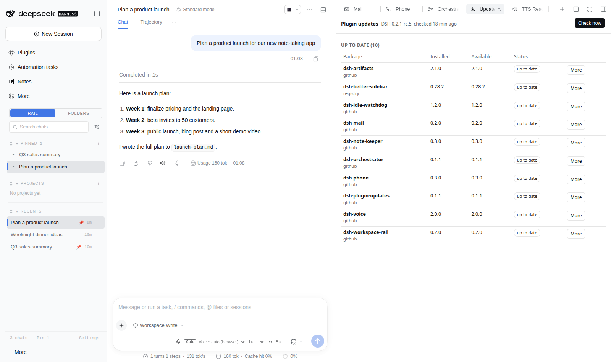

# dsh-plugin-updates

[](https://www.npmjs.com/package/@lucagiftzek/dsh-plugin-updates)

An update checker that only offers plugin releases your running DSH core can actually load.

```bash
dsh plugin --profile web add dsh-better-sidebar   # the tab host, skip if installed
dsh plugin --profile web add @lucagiftzek/dsh-plugin-updates
# or from GitHub: dsh plugin --profile web add github:lucagiftzek/dsh-plugin-updates
# restart dsh web, then open the Updates tab
```



<sub>Screenshot from a demo DSH instance with sample data.</sub>

A [DeepSeek Harness](https://www.deepseek.com) (DSH) web-profile plugin that tells you which of your installed plugins have a newer release **that your running DSH can actually take**. It only notifies. It never installs, never edits your profile, never runs a child process.

> **npm name.** The bare name `dsh-plugin-updates` is already taken on npm by an unrelated data package. This repository keeps the folder and package name `dsh-plugin-updates` for local use. If it is published, it will be published as `@jobopportunitiesapi/dsh-plugin-updates`. The loader row id stays `plugin-updates` either way.

## Why

Updating DSH plugins blind is risky. Two things go wrong in practice:

1. **Name collisions.** Many local plugins are `link:` folders or GitHub installs whose names also exist on npm as unrelated projects. A checker that looks packages up by name reports false "updates" and, if you approve, installs somebody else's package. This plugin classifies every dependency by its **specifier** (`^1.2.0`, `link:`, `github:`, a release tarball URL), never by its bare name.
2. **Wrong-core builds.** The newest release of a plugin often needs a newer DSH core than the one you run. Installing it can blank the whole web UI. This plugin applies the same compatibility rule as the DSH 0.2.1 loader against the **running** core version, so a 0.2.x-only build is never offered to a 0.1.5 host.

It also keeps a list of holds (versions you know to avoid), per package notes, and gives you a memory-capped apply command to copy, because a bare `pnpm add` on a busy machine can exhaust memory.

## What you get

- An **Updates** tab in the sidebar (needs `dsh-better-sidebar`, optional) with a live count badge, grouped results, links (npm, releases, changelog, compare), **Check now**, **Ignore this version**, **Snooze** and **Copy command**.
- A **Settings** section for the options below.
- A read-only agent tool `plugin_updates` (and `plugin_updates_doctor`).
- `GET /dsh-plugin-updates/api/doctor` and a bundled doctor skill.
- Zero configuration: defaults work as installed.

## Install (DSH web profile)

Install from npm: `dsh plugin --profile web add @lucagiftzek/dsh-plugin-updates`, or from GitHub: `dsh plugin --profile web add github:lucagiftzek/dsh-plugin-updates`.

```bash
dsh plugin --profile web add @lucagiftzek/dsh-plugin-updates
# or from GitHub: dsh plugin --profile web add github:lucagiftzek/dsh-plugin-updates
# then restart dsh web: the server half loads at start only
```

The package declares `dsh.bundle`, so `dsh plugin add` lists it in `dsh.profile.bundles`. A local checkout works too: clone it, run `npm install --omit=dev` in it, then `dsh plugin --profile web add link:/absolute/path/to/dsh-plugin-updates`. Requires Node 22.5 or newer and DSH 0.1.5-rc.1 up to (not including) 0.3.0. The browser half hot-reloads; only the server half needs the restart.

Kill switch without uninstalling: add `- id: plugin-updates` with `disabled: true` to the profile `cordis.patch.yml`, or set `DSH_PLUGIN_UPDATES_DISABLE=1`.

## Settings

Settings live in the `dsh-plugin-updates` namespace on DSH 0.1.5 (Settings page, stored in `settings.yaml`) and in the `plugin-updates` row of the profile `cordis.patch.yml` on DSH 0.2.x (settings forms). The plugin imports an old `settings.yaml` section once.

| Key | Default | Meaning |
|---|---|---|
| `enabled` | `true` | Master switch. |
| `intervalHours` | `12` | Hours between automatic checks (minimum 1). |
| `initialDelaySeconds` | `60` | Delay of the first check after start. After a restart the next check respects the last one, so restarts do not cause extra requests. |
| `registry` | `https://registry.npmjs.org` | Registry base URL. Must be on the host allowlist. |
| `allowHosts` | `[]` | Extra hosts, explicit opt-in only. |
| `githubTokenEnv` | `""` | The **name** of an environment variable that holds a GitHub token. Never the token. It is sent only to `api.github.com` and never stored or logged. |
| `channels` | `["latest"]` | Extra dist-tags to show (for example `next`). Never counted in the badge. |
| `holds` | seeded | Package name to a semver range to avoid. A value may end in `when dsh <range>` to apply only on some cores, for example `">=0.3.2 when dsh <0.2.0-0"`. |
| `upstream` | seeded | Local plugin (folder or package name) to `owner/repo`, or `owner/repo@<base>` to record the base version. Used for `link:` and `file:` plugins that are forks or clones. |
| `notes` | seeded | Per package notes shown next to the result. A note ending in ` when dsh <range>` (the hold syntax) is shown only while the running DSH matches that range. |
| `afterInstall` | `{}` | Per package reminder printed with the apply command (for example a patch script to re-run). |
| `checkOwnRemotes` | `false` | Compare plain local plugins with their github.com origin. |
| `snoozeDays` | `7` | Default snooze length. |
| `badge` | `true` | Show the count badge. |
| `badgeCountsIncompatible` | `false` | Also count updates that need a newer core. |
| `chatNotice` | `false` | Post one short notice per new finding set, at most once a day. Best effort; it never starts a model turn. |
| `runningDshVersion` | `""` | Test override of the detected DSH version. Leave empty. |

Seeded `holds` and `upstream` come from a manual audit of real plugins: they encode knowledge that registry metadata cannot carry (a desktop-only 0.2.x line, stepping-stone builds, an archived upstream). Replace them freely.

## How it decides compatibility

1. **Classify by specifier.** `registry` (semver range, tag, `npm:` alias) is checked on npm. `github:` and `git+https://github.com/...` are checked against GitHub tags and the default branch HEAD, with the pinned commit read from `pnpm-lock.yaml`. A `https://github.com/<owner>/<repo>/releases/download/<tag>/<file>.tgz` URL is checked against GitHub releases. `link:`, `file:`, `workspace:` are local: they are compared with an upstream only when the `upstream` map names them, or with their own github.com origin when `checkOwnRemotes` is on. Anything else (another git host, another tarball host) is shown as `manual`.
2. **Gate against the running core.** For each candidate version: if its `engines.dsh` is declared, that range decides alone; otherwise every `@deepseek-ai/dsh` and `@deepseek-ai/dsh-*` peer range must match. Matching uses `semver.satisfies(running, range, { includePrerelease: true })`, so `>=0.2.1` refuses an rc and `>=0.2.1-0` accepts it. The DSH 0.1.5 core has no gate of its own, so there the result is "declared compatible", not "verified". Nested `dsh.engines.dsh` ranges are shown as a hint only.
3. **Pick the newest stable version that passes the gate** and is not on a hold. A newer version that fails the gate is reported next to it ("0.28.2 needs a newer core"), never offered.
4. **Status** per package: `up-to-date`, `update-compatible`, `update-needs-newer-core`, `update-needs-older-core`, `no-declared-range` (the new version declares nothing, verify by hand), `held`, `snoozed`, `ignored`, `unreachable`, `manual`, `local`, `unknown`. A failed lookup is `unreachable`, never `up-to-date`.
5. **Caret traps.** If a fresh resolve of your declared range (`^0.7.4`) would pick a version your core cannot take, the package is flagged so you do not run a bare `pnpm update`.

The badge counts `update-compatible` only.

## Applying an update (you do it, not the plugin)

For a safe update the result carries `applyHint`, for example:

```bash
XDG_RUNTIME_DIR=/run/user/$(id -u) systemd-run --user --scope -p MemoryMax=1500M -p MemorySwapMax=0 \
  pnpm --dir "${DSH_HOME:-$HOME/.dsh}/profiles/web" add --save-exact --ignore-scripts <package>@<version>
```

The cap makes a runaway install kill only itself. Check `free -m` first. Git and release tarball dependencies get the matching `pnpm add 'name@github:owner/repo#ref'` or release URL form. Local forks get a manual hint (rebase onto the upstream tag), because no package manager command applies. Add `afterInstall` reminders for packages that need a follow-up step. The agent tool says the same: do not run `pnpm add`, `pnpm update` or `dsh plugin add` on your own; present the list and let the human decide.

## Agent tool and routes

`plugin_updates { scope?, package?, refresh? }` with `scope` one of `actionable` (default), `outdated`, `safe`, `held`, `local`, `all`. Read-only. `refresh: true` runs a new check (60 second cooldown).

Routes under `/dsh-plugin-updates/api`: `GET status`, `GET list?scope=`, `GET detail?pkg=`, `GET doctor`, `GET health`, `GET settings`, `POST refresh`, `POST ignore {pkg,version?}`, `POST unignore {pkg}`, `POST snooze {pkg,days?}`, `POST settings {patch}`. POSTs require the header `X-Requested-With: dsh-plugin-updates`, a JSON body, a matching `Origin` and a loopback connection (or the host connection admission when it offers one). None of them touches anything except the plugin's own state file.

## Privacy

- Only two hosts are ever contacted: **registry.npmjs.org** and **api.github.com**. Redirects to any other host are refused. `allowHosts` is an explicit opt-in that is empty by default.
- No telemetry, no catalog download, no mirrors, no analytics.
- The only data sent is package names, versions and repository names from your own profile, the same data `npm view` would send.
- Responses are cached with ETags in `$DSH_HOME/dsh-plugin-updates/state.json` (mode 0600), never in the profile. Registry and GitHub text is never shown or given to the model: only validated version strings and links the plugin builds itself.
- Unauthenticated GitHub access allows 60 requests per hour. A sweep of a large profile needs roughly 30 requests with ETags. The plugin stops below 10 remaining and reports the rest as `unreachable` until the reset.

## When something goes wrong

- Ask your agent to load the **`plugin-updates-doctor`** skill (bundled; see [docs/TROUBLESHOOTING.md](docs/TROUBLESHOOTING.md#start-here) if it is not listed).
- Run the self-check: `GET /dsh-plugin-updates/api/doctor` (no secrets in the output).
- Every error carries a stable `code`: [docs/ERRORS.md](docs/ERRORS.md).

The skill is registered automatically at the next `dsh web` start. Manual fallback:

```bash
P=$(node -p "require('path').dirname(require.resolve('dsh-plugin-updates/package.json',{paths:[(process.env.DSH_HOME||require('os').homedir()+'/.dsh')+'/profiles/web']}))")
mkdir -p "${DSH_HOME:-$HOME/.dsh}/skills" && cp -r "$P/skills/plugin-updates-doctor" "${DSH_HOME:-$HOME/.dsh}/skills/"
```

## Development

```bash
npm install          # dev dependencies: esbuild, react, react-dom, jsdom
npm run build        # bundles src/client.jsx to lib/client.js, verifies it loads like the browser loader does
npm test             # unit tests with mocked HTTP, fake 0.1.5 and 0.2.1 contexts, jsdom client boot
DSH_GLOBAL_PREFIX=/path/to/a/dsh-0.2.x/prefix npm test   # same suite against another DSH line
```

`test/dry-eval.mjs` evaluates a read-only copy of a real profile against the live registry. Release history: [CHANGELOG.md](CHANGELOG.md). License: MIT.

---

## More plugins by the same author

All of them are open source and run on DeepSeek Harness 0.2.x (several on 0.1.5 too).

| Plugin | What it does |
|:---|:---|
| [dsh-artifacts](https://github.com/lucagiftzek/dsh-artifacts) | An Artifacts tab that lists the files an agent produced and previews them in place, plus a template library agents can use and extend |
| [dsh-mail](https://github.com/lucagiftzek/dsh-mail) | Mail client and agent mail tools: IMAP, POP3, SMTP and OAuth2 accounts, scheduled and bulk sends with unsubscribe handling |
| [dsh-note-keeper](https://github.com/lucagiftzek/dsh-note-keeper) | Obsidian-compatible Markdown notes in the sidebar with search, graph, audio notes and transcription, OCR and client-side encryption |
| [dsh-phone](https://github.com/lucagiftzek/dsh-phone) | SMS and calls (Twilio, SIP via Asterisk) with call audio through your own server, live voicemail and Telegram |
| [dsh-voice](https://github.com/lucagiftzek/dsh-voice) | Read-aloud, dictation and language-aware speech with 23 TTS and STT providers, per-language routing and word highlighting |
| [dsh-orchestrator](https://github.com/lucagiftzek/dsh-orchestrator) | Agent swarm and task orchestration: an Orchestrate tab, `orch_*` tools, runners, provider cards and a machine API |
| [dsh-workspace-rail](https://github.com/lucagiftzek/dsh-workspace-rail) | A workspace-first sidebar rail: pinned chats, projects as folders, live Recents, search and unread markers |
| [DSH-Idle-Watchdog](https://github.com/lucagiftzek/DSH-Idle-Watchdog) | Idle-chat nudges and an authenticated HTTP API that posts a prompt into any chat |
| [dsh-plugin-updates](https://github.com/lucagiftzek/dsh-plugin-updates) (this one) | Update checker that only offers releases your running DSH core can load |
| [dsh-subagent-tiering](https://github.com/lucagiftzek/dsh-subagent-tiering) | Subagents default to a cheaper sibling of the parent model unless the agent names a route |
| [dsh-fs-reobserve](https://github.com/lucagiftzek/dsh-fs-reobserve) | Ends self-inflicted stale-file errors after an agent's own shell commands |
| [dsh-request-image-cap](https://github.com/lucagiftzek/dsh-request-image-cap) | Clamps every image sent to the model to a pixel cap, fixing many-image request errors |
| [dsh-seal](https://github.com/lucagiftzek/dsh-seal) | An encrypted channel in front of DSH: a Go reverse proxy plus a service worker that seal all DSH browser traffic |

Built by Luca Tzekos, who also makes [**Job Opportunities API**](https://jobopportunitiesapi.org): employer-direct job data with per-field provenance you can verify yourself, free to read and available as an API. If this plugin is useful to you, a star on this repo or a look at [jobopportunitiesapi.org](https://jobopportunitiesapi.org) is the best thanks.
